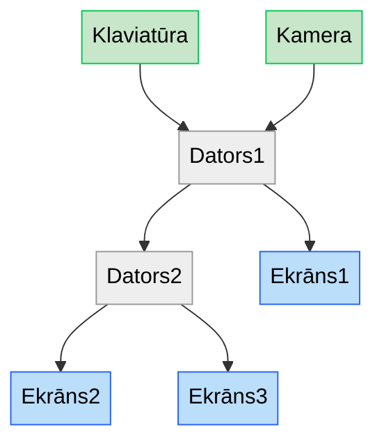

# Zinātnieku nakts 2026

Šajā repozitorijā ir kods un tā lietošanas apraksts, ko lietoju savā Zinātnieku nakts aktivitātē "Dzīvā attelu analīze".

## Shemātiskais zīmejums

Aktivitātē tika lietoti divi portatīvie datori (abos Linux 26.04 operētājsistēma), kamera Logitech, parasta klaviatūra, un trīs ekrāni rezultātu rādīšanai.

